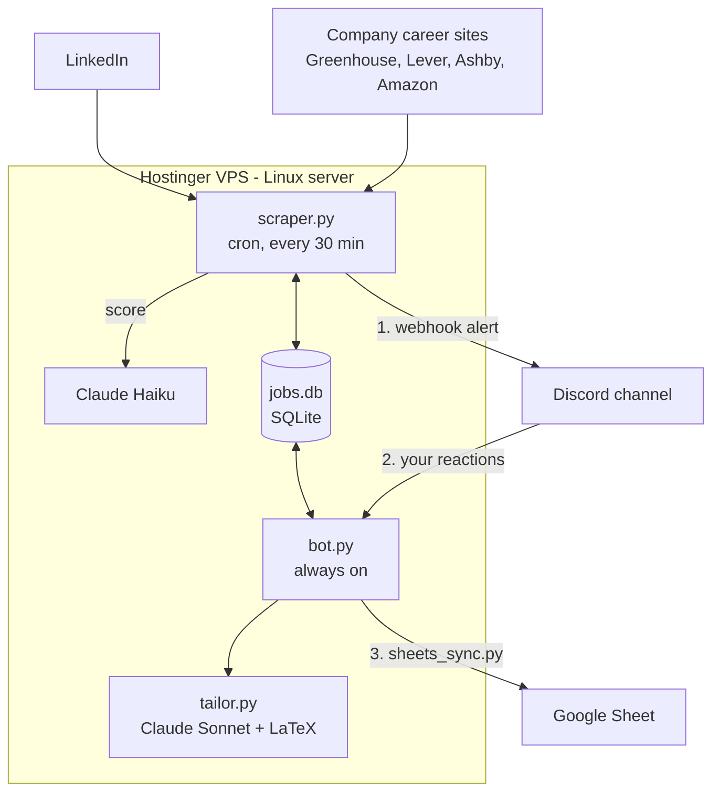

# Job Agent Explained

How the Job Agent works inside: what each part does, how data moves between the parts, and why it's built this way. This is a living document, updated as the system changes (see the Changelog at the end).

## The one-sentence version

A scraper runs every 30 minutes on a VPS, uses Claude to filter new job postings down to the ones that fit your resume, and sends them to Discord. A Discord bot then turns your emoji reactions into actions: tailoring your resume, logging applications, and learning from the jobs you dismiss.

## System map



## The parts

| Part | What it is | How it runs |
|---|---|---|
| `scraper.py` | Finds, filters and scores jobs, then sends alerts | **Cron job** every 30 min: starts, does one pass, exits |
| `career_sites.py` | Pulls postings straight from company job boards | Called by the scraper at the start of each run |
| `bot.py` | Listens to Discord reactions and `!commands` | **systemd service**: a background process the server keeps alive and restarts if it crashes |
| `tailor.py` | Writes a tailored resume and cover letter | Started by the bot as a separate process when you react ✅ |
| `sheets_sync.py` | Mirrors application status into the Google Sheet | Called by the bot on 📨 and `!status` |
| `jobs.db` | SQLite database file shared by scraper and bot | A single file on the VPS |

**Where it runs:** a **Hostinger VPS** (`srv1856705.hstgr.cloud`, IP `2.25.82.228`, managed from Hostinger's hPanel), in `/home/Haatim/job-agent/job-scout`. A VPS (virtual private server) is a rented Linux machine that stays on 24/7, which is what lets the bot run while your laptop is closed. Cron line: `*/30 * * * * .../venv/bin/python .../scraper.py`. The bot is the systemd service `jobscout-bot`. Logs go to `/var/log/jobscraper.log`.

The original project also had a web dashboard (Next.js + Supabase). **Your deployment doesn't use it**: the web-UI sync code was removed from the VPS copy, and the Google Sheet plays that role instead.

**Config files** (plain text, no code needed to edit):

- `candidate_profile.yaml`: who you are and what you want. Claude reads this when scoring.
- `scraper_config.json`: search terms, locations, company boards, keyword filters.
- `.env`: secrets (API keys, Discord IDs). Never committed to git.

# How a job gets from the internet to your Discord

## 1. Collect

- **LinkedIn**, through the JobSpy library. Every search term (SWE, AI/ML, applied AI, research and PM internships) is paired with every location (San Jose, Santa Cruz, San Francisco, Remote), limited to internship postings from the last 24 hours. That's 44 searches per run. "Remote" is sent as "United States" with a remote flag.
- **Company career sites**, through `career_sites.py`. Many companies host their job listings on an applicant tracking system (ATS) that publishes a public JSON feed. The scraper calls those feeds directly:
  - Greenhouse: `boards-api.greenhouse.io/v1/boards/<company>/jobs`
  - Lever: `api.lever.co/v0/postings/<company>`
  - Ashby: `api.ashbyhq.com/posting-api/job-board/<company>`
  - Amazon: `amazon.jobs/en/search.json`

  Each feed has its own format, so each one gets a small **adapter** function that converts its postings to the same dictionary shape JobSpy returns (title, company, location, job_url, description, date_posted). After that, the rest of the pipeline doesn't need to know where a job came from.

  Career-site postings are pre-filtered right away: the title must be an engineering/ML/data role **and** contain a whole-word "intern" keyword, and the posting must be less than 72 hours old.

## 2. The filter funnel

Every job passes through filters ordered **from cheapest to most expensive**. Free string checks run first; the paid Claude call runs last, on the few jobs that survive.

1. **Dedupe by URL.** Every URL ever processed is saved in `seen_jobs`. A seen URL is skipped immediately.
2. **Quick filter.** Cheap checks with no API call: drop excluded companies (e.g. Jobright, a job aggregator that reposts other companies' listings) and pay below the floor **for its interval**: under $40k if listed yearly, under $25 if listed hourly. (Career-site postings get a stricter title filter too, since company boards list every role: senior, sales, PhD, etc. are dropped before anything else.)
3. **Fetch details** (LinkedIn only). Download the job page to get the full description, the applicant count, and a "Reposted X ago" flag.
4. **Experience filter.** A regular expression rejects descriptions asking for 5+ years of experience.
5. **Duplicate role check.** If the same title at the same company was seen in the last 7 days (for example on both LinkedIn and the career site, or a repost under a new URL), skip it.
6. **Freshness filter** (LinkedIn only). Keep the job if it was posted in the last 2 hours **or** has fewer than 10 applicants. Reposts don't get the "fresh" pass because their timestamp is reset.
7. **Claude scoring.** See the next section.
8. **Alert.** Send a Discord embed.

Every job that's rejected at any step is still marked as seen, so it's never re-checked.

## 3. Claude scoring

The scraper calls **Claude Haiku** (the fast, low-cost model) with a prompt containing:

- your target roles, locations and disqualifiers from `candidate_profile.yaml`
- your qualifications (built from your resume)
- your most recent dismissal reasons (see the feedback loop below)
- the job's title, company, location, and the first 3,500 characters of the description

Claude must answer in **JSON only**:

```json
{ "relevant": true, "reason": "one sentence", "fit_score": 7,
  "experience_required": "0-1 years", "location_ok": true }
```

Structured JSON output means the code can read the answer directly, with no guessing from free text. A job is alerted only if `relevant` is true and `fit_score` is at least 5 (`min_fit_score` in the config).

**If Claude can't be reached** (out of credits, bad key, outage), the job is *not* marked seen. It's kept and retried next run, and you get one ⚠️ warning in Discord per day. That way an outage delays alerts but never loses jobs.

## 4. The alert

The Discord message is sent through a **webhook**: a secret URL that lets a script post into one channel without running a full bot. The embed shows the title, company, location, age, applicant count, source, fit score and Claude's reason, plus flags such as 🔥 FRESH, ⭐ WATCHLIST COMPANY, ♻️ REPOST, or 🏢 FROM COMPANY CAREER SITE.

# The Discord bot

`bot.py` stays logged in to Discord with the discord.py library and reacts to events.

| Reaction / command | What happens |
|---|---|
| ✅ | Runs `tailor.py` for that job: Claude Sonnet rewrites resume and cover letter content, LaTeX (`pdflatex`) compiles them into PDFs, and they're posted back to Discord |
| 📨 | Logs the job in the `applications` table and fills in the Google Sheet |
| ❌ | Asks why you're passing, then saves the reason to the `rejections` table |
| `!applied <url> <Company> - <Role>` | Log an application found outside the bot |
| `!status <url> <status>` | Move an application to phone_screen, interview, offer, rejected or withdrawn (also updates the sheet) |
| `!tracker`, `!stats`, `!note` | Show the pipeline, show stats, add a note |

**Why tailoring runs as a separate process:** generating and compiling documents takes a while. Running it in a separate process (through `run_in_executor`) keeps the bot responsive to other reactions in the meantime.

## The feedback loop (how it "learns")

When you dismiss a job with ❌ and give a reason, that reason goes into the database. On the next scraper run, your last 15 reasons are pasted into Claude's scoring prompt ("Haatim has recently passed on these roles and here's why"). Claude then scores similar jobs lower.

No model is retrained. The system adapts by changing **what goes into the prompt**, a technique often called in-context learning. It's cheap, it takes effect immediately, and you can see exactly why it changed.

# Data

## SQLite tables (`jobs.db` on the VPS)

| Table | Written by | Key columns | Purpose |
|---|---|---|---|
| `seen_jobs` | scraper | `job_url` (primary key), title, company, date_found | Dedupe: never process a job twice |
| `applications` | bot | `job_url`, title, company, status, date_added, notes | Your application pipeline |
| `rejections` | bot | job_url, title, company, reason, date_rejected | Feedback for Claude's scoring prompt |

SQLite is a database stored in one file with no server to run. That's enough when both programs are on the same machine.

The `rejections` table is created the first time you dismiss a job with ❌. As of 2026-09-28 the live database had 49,281 seen jobs, 0 logged applications, and no dismissals yet, so the feedback loop hasn't had anything to learn from.

## Why data lives in two places

- **SQLite on the VPS**: the working memory of the scraper and bot. Fast, local, zero setup.
- **Google Sheet**: your personal tracker, the view you actually read. `sheets_sync.py` keeps it in step when you react 📨 or run `!status`.

# Google Sheet sync

`sheets_sync.py` writes to the tracker with a Google **service account** (a bot identity with its own email that you share the sheet with, as you would a person). It turns on only when two `.env` values are set: `GOOGLE_SERVICE_ACCOUNT_JSON` (path to the key file) and `JOB_TRACKER_SHEET_ID`.

How it decides where to write:

1. A row with the same posting link → update Status only.
2. The same company with the same role → update Status only.
3. The same company with an empty Role cell (your pre-listed target companies) → fill in Role, Link, Status, Notes.
4. Otherwise → append a new row to the first tab.

It never touches the Contact or Resume Used columns. Failures are logged, not raised, so a Google outage can't crash the bot.

# Design decisions worth explaining

- **Two programs, not one.** Scraping is batch work (run, finish, exit), which is what cron is for. Reacting to clicks has to happen instantly at any time, which needs an always-on process. Separating them means a scraper crash can't take the bot down.
- **Cost-ordered funnel.** Regex and string checks are free and instant; a Claude call costs money and about a second. Putting the free filters first means Claude only sees a small fraction of postings.
- **Two Claude models.** Haiku for high-volume yes/no scoring, Sonnet for writing where quality matters (tailoring). The model is chosen per task by cost versus quality.
- **Adapters for sources.** Each job source gets a small function that converts its format to one shared shape. Adding a new source means writing one adapter, not touching the pipeline.
- **Config over code.** Search terms, companies and the candidate profile live in YAML/JSON, so retargeting the bot doesn't require editing Python.
- **Everything is marked seen.** Rejected jobs are recorded too, which keeps each run fast and avoids paying Claude twice for the same posting.
- **Fail soft.** One broken company feed, a failed page fetch, or a Sheets error is logged and skipped; the run continues.

# The 30-second explanation

> "It's an event-driven pipeline. A cron-scheduled Python scraper pulls postings from LinkedIn and directly from company job boards through small per-source adapters, then runs them through a cost-ordered filter funnel: dedupe, regex, freshness. Only the survivors go to Claude Haiku for a structured JSON fit score. Matches are pushed to Discord by webhook. A separate always-on Discord bot turns emoji reactions into actions: logging applications to a database and my Google Sheet, tailoring my resume with Claude Sonnet and LaTeX, and capturing rejection reasons that get fed back into the scoring prompt, so the filter adapts to my preferences without any retraining."

# Changelog

**2026-09-28: career sites, pay fix and sheet sync, built on the live VPS code** (local branch `vps`; deploy pending)

- Found that the VPS copy had already been retargeted to Haatim's internship search (SWE, AI/ML, research, PM; San Jose, Santa Cruz, SF, Remote; Jobright excluded; web UI removed). A first draft built from the GitHub fork was set aside so none of that would be overwritten; all new work starts from a snapshot of the server code.
- **Bug fix:** the pay filter compared every salary to $40,000/year, so an internship listed at $50/hour was rejected as "too low." It now uses the pay interval JobSpy reports ($40k yearly, $25 hourly).
- Added `career_sites.py`: 20 Greenhouse, 2 Lever and 5 Ashby boards plus Amazon, checked before LinkedIn, postings under 72 hours old.
- The same title at the same company within 7 days is now skipped, so a role on both LinkedIn and a career site alerts once.
- Added `sheets_sync.py`; 📨 and `!status` update the Google Sheet once credentials are configured.
- Deployed to the VPS the same day (backup at `~/job-scout-backup-2026-09-28/`). Google service-account key stored at `~/.config/job-agent/google-sa.json` (permissions 600) and the two settings added to `.env`.
- **Bug found in the first real test:** a 📨 reaction logged the application but didn't update the sheet, with no error. `bot.py` imports `sheets_sync` *before* it calls `load_dotenv()`, and `sheets_sync` read its settings at import time, so it always saw them as unset. Fixed by reading the settings when a sync runs, logging when a sync is skipped, and adding a regression test. The Neuralink application from that test was written to row 84. Lesson: settings read at import time depend on import order.
- **Found through the first live run: the Anthropic API credits had run out** (current outage since 9/26, 1:33 AM server time; an earlier one began 7/26). Every Claude call failed, and the scraper treated each failure as a rejection and marked the job seen, so **702 jobs were permanently skipped** and no alerts went out.
- Fixed: account errors (no credits, bad key) and temporary outages (rate limits, connection errors, server errors) now leave the job **unseen so the next run retries it**. After an account error the run stops calling Claude, and the bot posts one ⚠️ Discord warning per day. A one-off failure for a single job (e.g. Claude returns unreadable output) is still treated as a rejection, so no job can be retried forever.
- Lesson: failure paths need the same care as success paths. "Error" and "rejected" looked the same to the code, so an outage silently turned into lost data.
- 74 tests passing.
